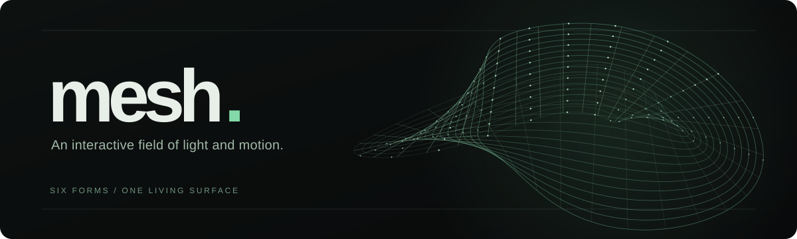

<div align="center">



<p><a href="https://dandekker.github.io/mesh./">Explore live</a> · <a href="#run-locally">Run locally</a> · <a href="#interact">Controls</a> · <a href="#how-it-works">How it works</a></p>

<p><a href="https://github.com/DanDekker/mesh./actions/workflows/ci.yml"></a></p>

</div>

---

**mesh. is an interactive WebGL particle sculpture.** A field of 7,680 points bends into six forms—Silk, Orbit, Wave, Knot, Sphere, and Cube—and responds to your pointer, touch, and scroll. Pull the surface, send a ripple through it, or let it move on its own.

Built by [Dan Dekker](https://github.com/DanDekker) with Bun, TypeScript, Web Components, and raw WebGL 2. The public version runs its physics in a browser worker, with no external packages, fonts, CDNs, or runtime services.

**[Try the live sculpture →](https://dandekker.github.io/mesh./)**

## Run locally

Requires [Bun 1.4.2+](https://bun.sh/) and a browser with WebGL 2.

```sh
git clone https://github.com/DanDekker/mesh..git
cd mesh.
bun run dev
```

Open **http://127.0.0.1:3000**. The dev command rebuilds browser files as source changes; refresh the page to see updates.

## Interact

| Input | Effect |
| --- | --- |
| Move over the field | Disturb nearby points. |
| Drag and release | Pull and fling the sculpture. |
| Tap or click | Send a ripple. Hold to strengthen it; tap twice for a stronger pulse. |
| Scroll | Wind or unwind the form. |
| 1–6 or arrow keys | Switch between the six forms. |
| Pause / Resume or Space | Pause or resume motion. |
| Reset or R | Return the active form to its resting shape. |

The page starts paused when your system requests reduced motion.
The live frame rate appears below the `mesh.` title to help you judge performance on your device.

## How it works

- [Geometry and forms](src/shared/field.ts) define the six shapes and their connections.
- [Simulation](src/physics/simulation.ts) applies motion, tension, pointer forces, and ripples in a browser worker.
- [Renderer](src/graphics/renderer.ts) draws the points and edges with WebGL 2.
- [Server](src/server.ts) serves only the built public assets and can connect an optional external field provider.

The public checkout works independently. If you have a private provider, set `MESH_PRIVATE_ADAPTER` in an untracked `.env` to its absolute path **outside this repository**. It implements the [provider contract](src/server/provider.ts); only particle coordinates cross the WebSocket connection. The provider's source, native libraries, and assets stay outside the browser build and static routes.

## Development

```sh
bun run check  # build, tests, and public-asset audit
bun run build  # write static browser files to dist/
bun start      # build and serve
```

The [build audit](scripts/audit.ts) checks public output and tracked files for private material. Generated binaries and private implementations belong outside this checkout.

Every push to `main` runs the checks and publishes the standalone browser build to GitHub Pages. A `v*` tag runs the same checks and creates a [GitHub release](https://github.com/DanDekker/mesh./releases) with a static site ZIP and checksum. The optional private provider is not part of either artifact.
